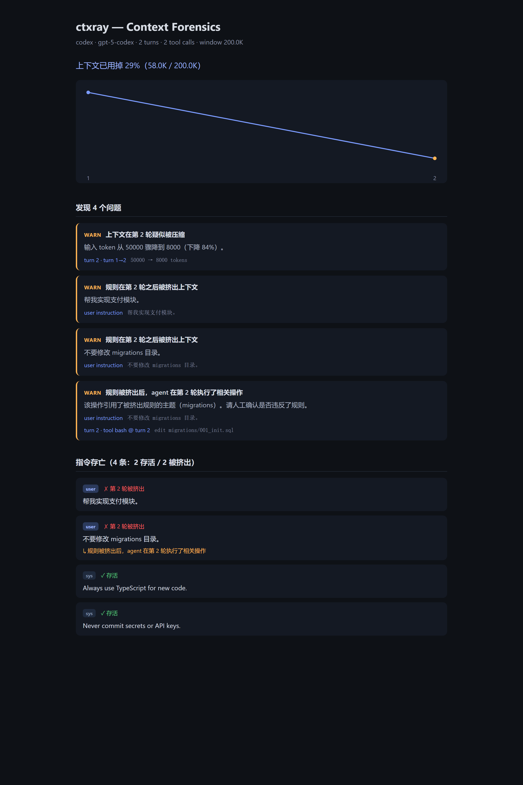

# ctxray · Context Forensics for AI coding agents

[](https://github.com/ProjectTorino/ctxray/actions/workflows/ci.yml)
[](https://www.npmjs.com/package/ctxray)
[](LICENSE)

> **Your agent didn't get dumber. Its context got evicted.**
>
> `ctxray` reads an agent's local session log and answers the *causal* question
> every other tool skips: **which of your rules fell out of the context window,
> when, and what the agent did wrong right after.**

Existing tools count tokens and dollars. ctxray is a postmortem tool — it
produces an incident report with line-level evidence.

```
ctxray — Context Forensics

  codex · gpt-5-codex · 2 turns · 2 tool calls
  context window 200.0K

  2 instructions fell out of the context window

Context usage (per turn)
  turn  1  ████████████████████████████████████████     50.0K
  turn  2  ██████      8.0K ◄ compacted

4 issues
  1. [WARN] Context likely compacted at turn 2
     Input tokens dropped from 50000 to 8000 (-84%).
  2. [WARN] Rule dropped from context after turn 2
     Implement the payment module.
  3. [WARN] Rule dropped from context after turn 2
     Do not modify the migrations directory.
  4. [WARN] Agent acted on an evicted rule at turn 2
     The action references topics from an evicted rule (migrations). Check whether it violated the rule.
     · turn 2 tool bash @ turn 2: edit migrations/001_init.sql

Rule survival (4 rules: 2 alive / 2 evicted)
  1. [user] ✗ evicted at turn 2  Implement the payment module.
  2. [user] ✗ evicted at turn 2  Do not modify the migrations directory.
     ↳ Agent acted on an evicted rule at turn 2
  3. [sys ] ✓ alive  Always use TypeScript for new code.
  4. [sys ] ✓ alive  Never commit secrets or API keys.
```

> That's the whole product in one screenshot: a rule was evicted by compaction,
> and the agent violated it one turn later. ctxray connects the two with
> evidence — no LLM, no API key, no cloud.

The same report also renders as a single self-contained HTML file (offline,
shareable, zero dependencies):



---

## Why this exists

In 2026 every agent ships a local session log, and the tools around it all stop
at the **counting layer** — "you spent $4.20, read `schema.ts` 12 times". Nobody
answers the questions developers actually ask:

1. *"It forgot the rules in my CLAUDE.md."* → which rule, which turn, squeezed out by what?
2. *"It went off the rails after a compaction."* → which instruction survived the summary, which didn't?
3. *"It kept re-reading the same file."* → how much did that waste, in tokens and dollars?

ctxray answers the **causal layer**: instruction survival, eviction → consequence,
and a waste ledger where every line carries its source.

## Features

- **Instruction survival tracking** — split the system prompt / user messages
  into rule blocks and track whether each is still in the window, turn by turn.
  *System directives* (re-sent every request) are never falsely marked evicted;
  *user instructions* are — because those are the ones compaction actually drops.
- **Eviction → consequence** — when a rule disappears, scan the following turns
  for tool calls whose arguments overlap the rule's keywords, and link them.
- **Compaction detection** — explicit summary events + a token-drop heuristic
  (input `50000 → 8000` = compaction).
- **Waste ledger** — duplicate reads (same content *and* same path), oversized
  tool outputs, each with a token estimate and the offending call.
- **Three output shapes** — colored terminal report, single-file HTML, and
  `--json` for scripting.

### How this differs from token counters

| Tool category | What it answers | What ctxray adds |
| --- | --- | --- |
| Spend dashboards (`ccusage`, Langfuse, …) | *How much* did I spend? | *Why*: which rule got squeezed out, and what broke after |
| Log viewers (`claude-code-log`, …) | *What* was on screen? | Causal link: evicted instruction → violating tool call, with line evidence |
| Context profilers | *Where* did tokens go? | Instruction **survival over time** + duplicate-read waste in dollars |

ctxray is local-first, agent-agnostic (Claude Code / Codex / DeepSeek Harness),
needs no API key, and every claim in the report cites the turn and text it came
from.

## Install

```bash
# try it right now — built-in demo session, no agent logs required
npx ctxray --demo

# or point it at a real session (zero install)
npx ctxray <session-file>

# or install globally
npm i -g ctxray
ctxray <session-file>

# not on npm yet? run straight from GitHub (npm builds it on install)
npx github:ProjectTorino/ctxray --demo
```

No API key. No network. Your logs never leave the machine.

## Usage

```
ctxray <session-file>                  terminal report (auto-detects source)
ctxray --demo                          built-in demo session (no file needed)
ctxray <session-file> --json           machine-readable JSON
ctxray <session-file> --html [--out f] single-file HTML report
ctxray <session-file> --budget <tokens>
                                       CI gate: fail if peak context > budget
                                       or any critical finding (exit 1)
ctxray <session-file> --lang zh        Chinese output (default is English)
```

### CI gate

Fail a build when a session blows its context budget:

```yaml
# .github/workflows/ctxray.yml
- name: Context budget gate
  run: npx ctxray .codex/sessions/**/rollout-*.jsonl --budget 60000
```

```
ctxray check: budget=60000 context=58000 critical=0 → PASS
```

## Supported sources

| Agent | Session file | Token counts |
|---|---|---|
| **Codex** | `.codex/sessions/**/rollout-*.jsonl` | real (`token_usage_record`) |
| **Claude Code** | `~/.claude/projects/**/*.jsonl` | estimated |
| **DeepSeek Harness (DSH)** | `.dsh/sessions/**/session.v4.jsonl.zstd` | estimated |

`.zstd` sessions are decompressed transparently (`fzstd`, pure WASM, no native
build). Source is auto-detected from the path and first JSON line.

## How it works

```
adapters/   one per agent → normalized Trace (turns, messages, tool calls, token usage)
reconstruct/ per-turn context size + compaction points
rules/      extract system directives + user instructions (dual-source)
survival/   which user rules a compaction dropped (exact match), link violations
events/     duplicate reads, oversized outputs
render/     terminal · HTML · JSON
```

Every conclusion is backed by evidence: the rule text, the turn, and the exact
tool call. ctxray never emits an unevidenced judgment — that's the product
contract (see `CONCEPT.md` §8).

## Development

```bash
npm install
npm run build      # esbuild → dist/ctxray.mjs + dist/index.mjs
npm test           # node --test (no build required, runs .ts directly)
```

Node ≥ 20. The only runtime dependency is [`fzstd`](https://www.npmjs.com/package/fzstd).

## Why "ctxray"

Context **X-ray** — you can't see inside the context window, so this is the
next best thing: a forensics read of the session log that reconstructs what was
in the window, what fell out, and what broke because of it.

## License

MIT
